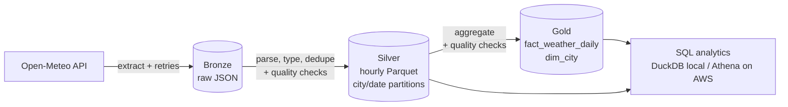

# Weather Lakehouse: an end-to-end data pipeline


A small but complete data-engineering project: it pulls hourly weather data from a public API,
stores it in a data lake layout using the **medallion architecture** (bronze / silver / gold), validates it
with automated data-quality checks, and serves a star schema for SQL analytics. The same code runs on
local disk (queried with **DuckDB**) and on AWS (S3 + **Amazon Athena**).

**Status:** verified end to end locally with the real API (5 German cities, 31 days) and covered by 60
automated tests. The AWS path (S3 + Athena) is implemented and documented below, but has not been deployed yet.



## Layers

| Layer  | Content | Format | Location (S3 key) |
|--------|---------|--------|-------------------|
| Bronze | unchanged API response + metadata (source, ingestion time) | JSON | `bronze/weather/city=<c>/start=<d>_end=<d>/raw.json` |
| Silver | cleaned, typed, de-duplicated hourly measurements | Parquet, Hive-partitioned | `silver/hourly_weather/city=<c>/date=<d>/part.parquet` |
| Gold   | daily facts per city + city dimension (star schema) | Parquet | `gold/fact_weather_daily/`, `gold/dim_city/` |

**Gold grain:** one row per city and day (`min/avg/max temperature`, `total precipitation`,
`max wind`, `hours_observed`, `is_rainy_day`).

## Quickstart (local)

```bash
python3 -m venv .venv && source .venv/bin/activate
pip install -r requirements.txt
export PYTHONPATH=src                      # or: pip install -e .
python3 -m pytest -v                        # 60 tests
python3 -m weather_pipeline.run --start 2025-01-01 --end 2025-01-07
ls data/gold/fact_weather_daily/           # data/ is the local "data lake"
```

Useful options: `--cities munich,berlin`, `--steps silver,gold` (re-process without calling the API).

## Running without AWS (DuckDB)

AWS is optional. The pipeline writes the same Parquet layers to `./data`, and
[DuckDB](https://duckdb.org/) queries them with SQL, which takes the role Athena has in the cloud setup:

```bash
python3 -m weather_pipeline.run --start 2025-01-01 --end 2025-01-31   # all 5 cities
python3 scripts/query_local.py        # run the example analytics queries (or: ... 3 for one query)
```

`scripts/query_local.py` exposes `dim_city`, `fact_weather_daily` (gold) and `silver` as views and runs the
queries from [`sql/gold_queries.sql`](sql/gold_queries.sql), adapted for DuckDB. Moving to S3 + Athena later
only changes where the files live (`STORAGE_BACKEND=s3`), not the pipeline code.

## Running on AWS

1. **Bucket and credentials**
   ```bash
   aws s3 mb s3://<your-bucket> --region eu-central-1
   aws configure                          # or use SSO / an IAM role
   ```
2. **Minimal IAM policy** for the pipeline (least privilege, one prefix only):
   ```json
   {
     "Version": "2012-10-17",
     "Statement": [
       {"Effect": "Allow", "Action": ["s3:GetObject", "s3:PutObject"],
        "Resource": "arn:aws:s3:::<your-bucket>/weather-pipeline/*"},
       {"Effect": "Allow", "Action": "s3:ListBucket",
        "Resource": "arn:aws:s3:::<your-bucket>",
        "Condition": {"StringLike": {"s3:prefix": "weather-pipeline/*"}}}
     ]
   }
   ```
3. **Run it**
   ```bash
   export STORAGE_BACKEND=s3 S3_BUCKET=<your-bucket>   # optional: S3_PREFIX (default weather-pipeline)
   python3 -m weather_pipeline.run
   ```
4. **Query it:** open Athena, set a query-result location, replace `<BUCKET>`/`<PREFIX>` in
   [`sql/athena_ddl.sql`](sql/athena_ddl.sql) and run it, then try [`sql/gold_queries.sql`](sql/gold_queries.sql).
   Silver uses *partition projection*, so no crawler or `MSCK REPAIR TABLE` is needed.
5. **Schedule it:** e.g. a GitHub Actions workflow on a cron schedule that assumes an IAM role via OIDC
   (no long-lived AWS keys), EventBridge + Lambda, or Airflow/Dagster for larger setups.

> Cost note: this project stores a few MB and runs a handful of Athena queries, which is
> far below typical free-tier or cent-level costs. Delete the bucket when you are done.

## Design decisions (the "why")

- **Idempotency:** object keys are derived from the requested window and partitions are overwritten,
  so re-running any step never creates duplicates. Gold is rebuilt from all silver partitions.
- **Medallion layers:** bronze keeps the raw truth (reprocessing without calling the API again),
  silver is the clean reusable base, gold is modelled for analytics.
- **Fail fast on bad data:** quality checks (not-null, uniqueness, value ranges, null ratio, row counts,
  `min <= avg <= max`) run *before* data is written to the next layer. A failure exits with code 2.
- **Resilient extraction:** retries with exponential backoff for network errors, HTTP 429 and 5xx;
  4xx errors fail immediately because retrying cannot help.
- **Partitioning:** Hive-style `city=/date=` paths keep Athena scans small and cheap.
  Partition columns live in the path, not in the file.
- **Storage abstraction:** `LocalStorage` and `S3Storage` share one interface, so tests need no AWS access.
- **Atomic local writes:** write to a temp file, then rename, so readers never see half-written files.
- **Testability:** pure functions for transformations, injectable HTTP session and `sleep`,
  in-memory storage for end-to-end tests.

## Project layout

```
src/weather_pipeline/   config, storage, extract, transform, quality, run (CLI)
tests/                  unit + end-to-end tests (extract retries, transforms, DQ checks, idempotency)
sql/                    Athena DDL + analytics queries on the gold layer
scripts/                query_local.py: run the gold queries locally with DuckDB
sql_practice/           20 SQL exercises with verified solutions (window functions, SCD2, gaps & islands, ...)
python_practice/        10 data-engineering Python tasks with tests
.github/workflows/      CI (pytest on every push)
```

## Ideas to extend it

- Replace the pandas transforms with **PySpark / Databricks** or move the gold models into **dbt**
  (tests and documentation included).
- Orchestrate with **Airflow/Dagster** instead of cron; add alerting on failure (SNS/Slack).
- Infrastructure as code with **Terraform** (bucket, IAM role, Glue database, Athena workgroup).
- Convert silver/gold to **Delta Lake / Iceberg** for upserts and time travel.
- Add **data lineage and a catalog** (Glue Data Catalog, Lake Formation permissions).

## Data source

[Open-Meteo](https://open-meteo.com/) historical weather API (free for non-commercial use, no API key).
The archive lags a few days behind, so the default window is the 7 days ending a week ago.

